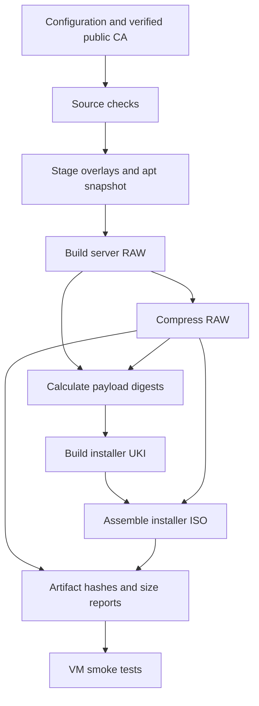

# How SC Linux works

[Home](../README.md) · [Build](building.md) · [Verification](verification.md)

SC Linux keeps the *build environment* separate from the *installed operating system*.

## Repository layout

| Path | Purpose |
| --- | --- |
| `book/` | Nine-chapter teaching sequence and book reference |
| `docs/` | Task guides and historical change records |
| `notebooks/01-*` through `04-*` | Compact, interactive workflow |
| Named `notebooks/*.ipynb` | Canonical host-side validation, staging, image packaging and tests |
| `scripts/notebook.sh` | Execute the same notebook code noninteractively in CI |
| `scripts/*.sh` | Docker, mkosi and reproducibility orchestration |
| `config/` | Version pins and FreeIPA identity |
| `images/server/` | Server mkosi recipe, partition layout and system files |
| `images/installer/` | Installer UKI recipe, units and disk installer |
| `lib/scos/core.py` | Validation helpers shared by host operations and installed commands |
| `tests/` | Python unit tests for safety and compatibility |
| `trust/` | Operator-reviewed public IPA CA certificate |
| `build/` | Ignored images, metadata, VM logs and notebook working copies |

The [notebook guide](notebooks.md) explains the teaching, operational and implementation layers. Installed programs and unit tests use ordinary Python files and run without Jupyter.

## The build sequence

The source tree is mounted read-only into a privileged builder container, then copied into a temporary workspace. Metadata records the committed source revision and timestamp. The installer includes both the compressed RAW and expected payload digests.

## What is on the server?

Debian 13, systemd, UEFI UKI, a 384 MiB ESP, and a writable ext4 root with a **2 GiB minimum**. The actual RAW size depends on package footprint and mkosi partition minimization. `systemd-repart` is configured to grow the root on suitable targets, but that growth behavior still needs dedicated acceptance tests.

The server has DHCP networking, cloud-init NoCloud provisioning, SSH and FreeIPA client packages. The initial disk image does **not** contain a host keytab, SSH host private keys, or enrollment password.

## What is on the ISO?

A minimal memory-resident UEFI installer plus the compressed server RAW. It starts an explicit installer console; there is **no automatic target disk selection**. The installer validates the disk and payload, demands confirmation, writes the image and reads it back.

## Security boundary

TPM measurements provide diagnostics, not a remote authorization verdict. Optional Secure Boot signing does not protect writable ext4 contents. FreeIPA enrollment is a separate manual action after each host is provisioned. See [Security](../SECURITY.md).
