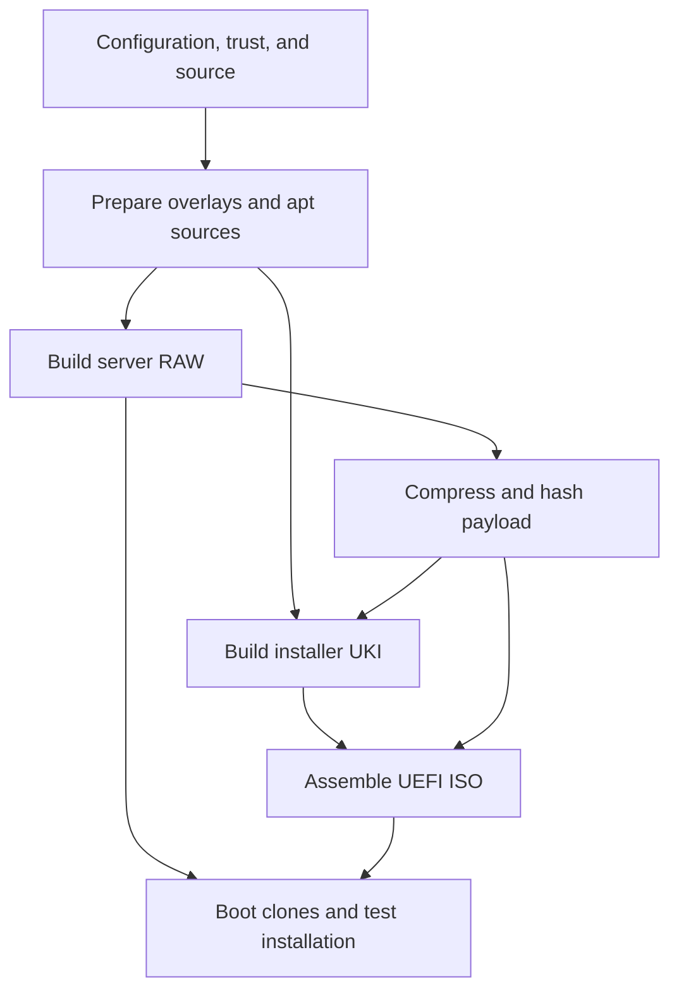

# Architecture

[README](../README.md) · [Build](building.md) · [Verify](verification.md)

## Repository map

| Directory | Responsibility |
| --- | --- |
| `config/` | Build snapshot, toolchain selection, and explicit IPA identity |
| `images/server/` | Server mkosi recipe, partition definitions, finalizer, and overlay |
| `images/installer/` | Installer mkosi recipe, console units, and disk installer |
| `lib/scos/` | Shared validation and hashing, copied into both images |
| `scripts/` | Host build, trust, seed, packaging, and smoke-test commands |
| `tests/` | Source-level regression tests and shared test support |
| `trust/` | Operator-provided public CA and verified fingerprint |
| `docs/` | Operating guides, verification record, references, and change notes |
| `build/` | Ignored generated inputs, builder metadata, images, and logs |

Each image overlay mirrors its destination filesystem. Shared code has one
canonical location, `lib/scos/`, and is staged to `/usr/local/lib/scos/`.
Installed commands import it as `scos.core`.

## Build flow

`scripts/build.sh` requires a clean checkout and launches the pinned local
builder with source mounted read-only. `build-inside.sh` copies source into
container-local scratch space. `prepare.py` creates two overlays and a mkosi
sandbox containing the selected apt sources.

The server build produces the RAW disk. Its compressed and uncompressed hashes
are embedded in the installer overlay before the installer UKI is built. The ISO
contains an EFI boot image and that compressed payload. The installer checks
both payload representations before opening the selected disk for writing.

## Server image

The server recipe uses Debian packages, systemd, a UKI at the UEFI fallback boot
path, and native FreeIPA client packages. The GPT layout has a 384 MiB EFI System Partition and a writable ext4
root starting at 2 GiB, with `Minimize=guess` estimating required space.
The installed `systemd-repart` policy targets expansion onto larger disks;
its behavior still requires an image-build and VM-boot acceptance run.

The finalizer registers CA trust, enables networking and provisioning units,
locks root, clears machine-specific state, and checks the filesystem for secrets.
It removes disposable caches, then exports package and filesystem-size reports
into the build outputs rather than the deployed root.
The deployed machine initializes its machine ID and SSH host keys independently.

Systemd-networkd manages matching Ethernet interfaces. Systemd-resolved provides
DNS, systemd-timesyncd provides clock synchronization, and cloud-init accepts
NoCloud provisioning. SSH password and root login are disabled.

## Installer image

The second recipe builds a memory-resident installer UKI. Its target starts an
interactive root shell and never selects a disk automatically. `scos-install`
verifies payloads, validates the whole-disk target, requires explicit confirmation,
writes and reads back the image, then relocates the backup GPT header.

The installer is an optical UEFI image. The server RAW is the direct disk artifact;
the ISO is not a RAW image with a different extension.

## Boot evidence

On compatible UEFI/TPM hosts, `scos-measure` stores the firmware event log, parsed
event log, selected SHA-256 PCR values, and a summary under `/run/scos/boot/`.
It does not extend PCRs with post-boot file hashes.

The boot smoke harness recognizes its `SCOS_BOOT_MEASURED` console marker and
checks machine-ID uniqueness. It does not verify a hardware endorsement key,
a remote quote, Secure Boot enforcement, or writable-root integrity.

## Stable interfaces

The rewrite retains `make check`, `builder`, `images`, `smoke`, and `repro`, the
`scripts/` command paths, installed `scos-*` command names, and final artifact names.
Bare `make` now displays command help; use `make check` to run validation.
Source image paths moved from `mkosi/`, `overlay/`, and `installer/` into `images/`.
See [the rewrite record](changes/2026-10-16-readability.md).

See [upstream references](upstream.md) for the pinned interfaces.
